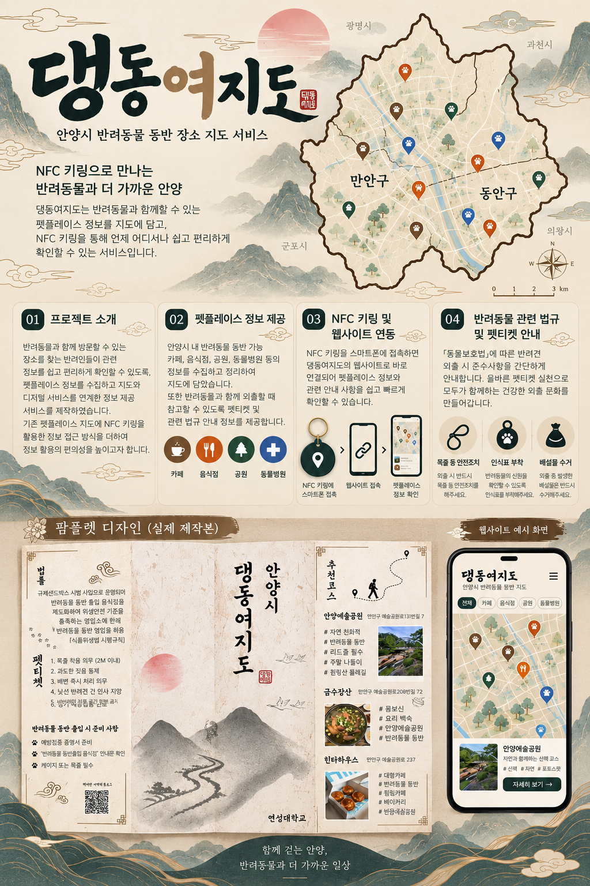

# 댕동여지도(PetMap) 통합 프로젝트 기획서

> 반려동물과 함께 갈 장소를 지도에서 찾고, 이용자 제보와 경험으로 정보를 함께 채워 가는 안양시 반려동물 동반 장소 서비스

- **문서 목적:** 초기 MVP, 클라이언트 요구사항, 지도 데이터 표현 기획, 현재 프로젝트 기능 및 시각 콘셉트를 하나의 기준 문서로 통합한다.
- **서비스명:** 댕동여지도 (PetMap)
- **서비스 지역:** 안양시 만안구·동안구 중심
- **문서 기준일:** 2026-11-14
- **상태 표기:** 구현은 현재 서비스에서 제공하는 기능, 부분 구현은 요구사항 일부가 제공되는 기능, 계획은 설계 또는 향후 개발 대상이다.

## 1. 프로젝트 소개

### 1.1 배경과 문제

반려동물과 외출할 때는 장소 위치만으로 방문 여부를 판단하기 어렵다. 동반 가능 여부와 조건, 영업시간, 전화번호, 실제 이용 후기처럼 필요한 정보가 여러 곳에 흩어져 있거나 최신 상태가 아닐 수 있다.

댕동여지도는 반려동물 동반 장소를 지도에서 찾고, 장소 정보와 이용자 경험을 확인하며, 부족한 내용은 제보로 보완하는 지역 기반 웹 서비스다.

### 1.2 목표

- 안양시의 반려동물 동반 장소를 한 지도에서 탐색한다.
- 카테고리와 상세 정보를 통해 방문 전 필요한 내용을 확인한다.
- 이용자 제보를 관리자 검토 후 공개해 정보의 정확성과 품질을 관리한다.
- 평점, 댓글, 즐겨찾기, 코스 공유로 지역 이용 경험을 축적한다.

### 1.3 주요 이용자

- **장소 탐색자** — 필요와 활동: 장소 검색, 지도 탐색, 동반 조건과 상세 정보 확인
- **제보자** — 필요와 활동: 새 장소 등록, 기존 정보·사진·영업시간 보완
- **회원** — 필요와 활동: 평점·댓글 작성, 장소 저장, 방문 코스 작성·공유
- **관리자** — 필요와 활동: 제보 검토, 공개 장소와 카테고리 관리
- **업체 운영자** — 필요와 활동: 장기 확장 대상. 업체 인증 및 직접 정보 관리 기능은 현재 범위에 포함하지 않음

## 2. 제품 원칙과 시각 방향

### 2.1 제품 원칙

1. **방문 판단에 필요한 정보 우선:** 장소명과 위치뿐 아니라 전화번호, 영업시간, 동반 조건 등 실용 정보를 제공한다.
2. **정보의 출처와 상태를 명확히:** 이용자 제보는 검토 절차를 거쳐 공개한다.
3. **지역에 맞는 탐색:** 초기에는 안양시와 만안구·동안구의 지역 맥락에 집중한다.
4. **지도에서 빠르게, 상세 화면에서 충분히:** 지도는 탐색에 필요한 요약을, 상세 패널은 방문 결정을 위한 정보를 제공한다.

### 2.2 브랜드·화면 콘셉트

첨부 시안의 동양화·옛 지도 분위기, 안양 지역 지도, 카테고리별 핀, 팸플릿과 모바일 화면을 시각 참고 자료로 삼는다. 실제 서비스에 적용된 화면과 시안은 구분한다.

- **브랜드 문구:** “NFC 키링으로 만나는 반려동물과 더 가까운 안양”은 확장 콘셉트다.
- **표현 방향:** 따뜻한 종이 질감과 동양풍 일러스트, 알아보기 쉬운 지도와 정보 패널을 조화시킨다.
- **지도 색상:** 식당·카페·공원·동물병원 등 주요 카테고리를 색상과 아이콘으로 구분하는 것을 목표로 한다.
- **지역 경계:** 만안구와 동안구를 지도에서 구별한다.
- **주의:** 첨부 이미지의 팸플릿, NFC 키링, 법규 안내와 일러스트형 지도는 콘셉트 시안이며, 현재 기능 구현 여부는 8장의 상태표를 따른다.

## 3. MVP와 핵심 이용 흐름

### 3.1 장소 탐색

지도 진입 → 장소명 검색 또는 카테고리 선택 → 마커/검색 결과 확인 → 장소 선택 → 상세 정보·후기 확인 → 찜 또는 코스에 저장

### 3.2 장소 정보 제보

새 장소 또는 기존 장소 정보 제안 → 필요한 정보 입력 및 제출 → 관리자 승인 요청 목록에 등록 → 관리자 확인·수정·승인 → 승인된 내용 공개

### 3.3 코스 공유

장소 선택 → 순서대로 코스 구성 → 제목·소개·공개 여부 설정 → 공개 코스 탐색·추천·공유

### 3.4 MVP 범위

- 지도와 장소 마커, 검색, 카테고리 필터
- 장소 상세 정보 및 사진
- 신규 장소 제보와 기존 정보 수정 요청
- 관리자 승인·장소 관리
- 회원 계정, 닉네임, 평점, 댓글, 즐겨찾기
- 여러 장소를 묶는 코스 생성 및 공유

## 4. 지도와 장소 정보 표현

이 절은 지도 데이터 표현 기획을 서비스의 목표 동작으로 정리한 것이다. 줌 단계별 요약·클러스터 기능 중 구현되지 않은 부분은 계획으로 남긴다.

### 4.1 정보 계층

- **지역 요약** — 지도에서 보여줄 정보: 시·구 등 넓은 지역의 장소 수와 분포；사용자 목적: 어느 지역에 장소가 많은지 파악
- **구역 묶음** — 지도에서 보여줄 정보: 지도 영역별 장소 수 또는 카테고리별 분포；사용자 목적: 관심 지역을 좁히기
- **동네·상권** — 지도에서 보여줄 정보: 카테고리 중심의 장소 분포；사용자 목적: 원하는 종류의 장소 찾기
- **개별 장소** — 지도에서 보여줄 정보: 장소명 또는 카테고리 마커；사용자 목적: 특정 장소 선택
- **상세 정보** — 지도에서 보여줄 정보: 사진, 주소, 전화번호, 영업시간, 동반 조건 등；사용자 목적: 방문 여부 결정

단계 전환은 고정된 줌 숫자만으로 결정하기보다 화면에 표시되는 장소 수와 가독성을 함께 고려한다.

### 4.2 표시·상호작용 규칙

- 검색어와 필터는 지도 표시 장소와 검색 결과에 일관되게 반영한다.
- 밀집 구간은 장소 수 또는 카테고리별 분포를 묶어 보여주는 클러스터를 목표로 한다.
- 개별 마커는 기본·포커스·선택 상태를 구분한다. 선택 상태는 다른 마커보다 명확하게 표시한다.
- 마커를 선택하면 공용 상세 패널/모달에서 장소의 주요 정보를 확인한다.
- 평균 평점과 평점 수를 함께 보여준다. 평가가 없으면 0점으로 오해되지 않도록 ‘평가 없음’ 등으로 표현한다.
- 현재 위치 기능을 도입할 경우 사용자 위치 표시는 장소 마커와 시각적으로 구분하고, 위치 권한과 저장 여부를 명확히 한다.
- 지도 이동이 잦을 때는 움직임이 끝난 뒤 조회하고, 현재 화면 범위에 필요한 데이터만 요청하는 방식을 목표로 한다.

### 4.3 장소 상세 정보

정보가 등록된 항목만 표시하고, 미확인 정보를 임의로 확정하지 않는다.

- 장소명, 카테고리·세부 분류
- 주소와 지도 위치
- 대표 사진 및 추가 사진
- 전화번호, 영업시간
- 반려동물 동반 가능 여부와 장소별 이용 조건
- 메뉴·메모·태그 및 외부 지도 링크
- 평균 평점, 평점 수, 댓글·후기
- 즐겨찾기 및 코스 추가

### 4.4 검색과 필터

- 장소명·키워드 기반 검색과 카테고리 필터를 제공한다.
- 음식점 세부 분류는 음식점 선택 시에만 제공한다.
- 여가·문화, 케어·돌봄, 전문 서비스 분류는 각 영역의 기타를 별도로 둔다.
- 검색 결과는 검색 입력을 가리지 않도록 별도 결과 영역에 표시하는 방향으로 구성한다.
- 향후 지도 범위, 줌 수준, 카테고리를 함께 사용해 조회량과 표시 밀도를 조절한다.

## 5. 장소 데이터와 사용자 기능

### 5.1 장소 데이터

장소는 이름, 주소, 위도·경도, 카테고리, 전화번호, 영업시간, 사진, 태그, 메모, 메뉴 및 식당 세부 분류 등을 가질 수 있다. 실제 방문 판단에 중요한 동반 조건은 정보가 확인된 범위에서 제공한다.

### 5.2 제보와 작성자

- 회원 제보에는 계정에 설정된 닉네임을 사용한다.
- 비회원 제보에는 무작위 닉네임을 사용한다.
- 신규 장소와 기존 장소 수정 요청은 관리자 검토 전까지 공개 데이터에 바로 반영하지 않는다.
- 사진·영업시간·전화번호·태그 등 장소 정보 보완을 지원한다.

### 5.3 평점·댓글·즐겨찾기

- 회원은 장소에 1~5점 평점을 남길 수 있다.
- 회원과 비회원 댓글, 댓글 이미지 첨부 및 회원 좋아요를 지원한다.
- 회원은 장소를 즐겨찾기에 저장하고 폴더명이나 메모로 정리할 수 있다.
- 상세 평가 항목, 댓글 대댓글·신고 등은 별도 후속 범위로 관리한다.

### 5.4 코스

회원은 여러 장소를 순서대로 묶어 코스를 작성할 수 있다. 제목, 소개, 지역, 분류, 공개 여부를 설정하며 공개 코스의 탐색·정렬·추천·즐겨찾기와 링크 공유를 지원한다.

## 6. 관리자 운영

### 6.1 장소 관리

관리자 장소 관리 화면은 ‘현재 적용된 장소’와 ‘승인 요청’으로 나눈다.

- 현재 장소: 목록 검색·카테고리 필터, 개별/전체 선택, 수정·삭제
- 승인 요청: 개별/전체 선택, 일괄 승인·삭제, 요청 상세 검토
- 검토 화면: 장소명, 카테고리, 주소, 요청자, 요청 시각 및 수정 내용 확인
- 상세 검토 모달에서 이전·다음 요청으로 이동
- 공용 카테고리 선택 UI로 제보와 관리 화면의 분류 기준을 일치

### 6.2 데이터 품질 관리

실제 장소 자료는 주소와 좌표를 확인해 등록하고, 자동 매칭이 불확실한 장소는 수동 확인한다. 지도 공급자의 검색 결과는 보조 자료로 사용하며, 운영자가 확인한 제보와 구분한다.

## 7. NFC·펫티켓 안내 확장

첨부 시안의 NFC 키링과 팸플릿은 서비스의 오프라인 접점을 넓히는 제안이다. 현재 서비스 기능과 혼동하지 않도록 후속 과제로 둔다.

- **NFC 키링:** 태그에 서비스 또는 특정 장소/코스의 웹 주소를 연결해 스마트폰으로 빠르게 열기
- **대체 접근:** NFC를 지원하지 않는 이용자를 위해 QR 코드와 직접 URL 제공
- **펫티켓 안내:** 목줄·인식표·배변 처리 등 반려동물 동반 외출 안내를 웹과 인쇄물로 제공
- **운영 조건:** 법률·공공 안내는 출처와 기준일을 표시하고, 변경 여부를 주기적으로 확인
- **후속 검토:** 키링 제작·배포, NFC 대상 URL 관리, 안내 콘텐츠 책임자와 갱신 주기 결정

## 8. 요구사항 및 구현 상태

- **안양시 반려동물 동반 장소 지도** — 현재 상태: 구현；설명: 등록 장소를 카카오 지도에서 탐색
- **장소 검색 및 카테고리 구분** — 현재 상태: 구현；설명: 키워드 검색과 카테고리·세부 분류 필터
- **만안구·동안구 구분** — 현재 상태: 구현；설명: 지도에 지역 경계 표시
- **마커 선택 후 장소 정보 확인** — 현재 상태: 구현；설명: 상세 패널에서 등록된 장소 정보 제공
- **전화번호·영업시간·사진·메모 등** — 현재 상태: 구현；설명: 데이터가 등록된 항목을 상세 정보에 노출
- **사용자 제보 및 관리자 승인** — 현재 상태: 구현；설명: 신규 제보·수정 요청을 관리자 검토 후 반영
- **회원 평점·댓글·즐겨찾기** — 현재 상태: 구현；설명: 세부 범위는 5.3 참고
- **사용자 코스 작성·공유** — 현재 상태: 구현；설명: 공개/비공개 코스와 링크 공유 등 제공
- **동양풍 브랜딩·카테고리별 색상 핀** — 현재 상태: 부분 구현/디자인 과제；설명: 시안 방향이며 시각 스타일의 전체 적용 여부는 화면별로 다름
- **확대 시 일러스트 노출** — 현재 상태: 계획；설명: 시안에 포함. 줌 단계별 장식과 정보 표현은 추가 개발 필요
- **줌 단계별 지역 요약·클러스터** — 현재 상태: 계획；설명: 데이터 표현 설계에는 포함되나 현재 클러스터링은 확인되지 않음
- **현재 위치 기반 탐색** — 현재 상태: 계획；설명: 위치 권한 기반 사용자 위치 조회·주변 탐색은 후속 구현
- **NFC 키링과 펫티켓 콘텐츠** — 현재 상태: 콘셉트/계획；설명: 첨부 시안에 제안되었으나 현재 서비스 기능은 아님
- **OAuth 소셜 로그인** — 현재 상태: 설정 필요；설명: 공급자 설정에 따라 사용 가능 여부가 달라짐
- **업체 인증 및 직접 관리** — 현재 상태: 계획；설명: 현재 관리자 장소 관리와 별도인 확장 기능

## 9. 기술 구성 및 운영

- **웹** — 구성: ASP.NET Core Blazor Server, C#
- **지도·장소 검색** — 구성: Kakao Maps JavaScript SDK 및 장소 검색 연동
- **데이터베이스** — 구성: 개발 SQL Server LocalDB, 운영 Docker 기반 SQL Server
- **데이터 접근·스키마** — 구성: Entity Framework Core, 마이그레이션
- **배포** — 구성: Docker Compose, AWS Lightsail
- **HTTPS·도메인** — 구성: Caddy 자동 TLS, Cloudflare DNS
- **계정 이메일** — 구성: SMTP 기반 인증·비밀번호 재설정
- **영속 파일** — 구성: 업로드 파일과 Data Protection 키를 영구 저장소에 보존

### 운영 원칙

- 비밀 키와 비밀번호는 저장소에 기록하지 않고 환경 변수로 관리한다.
- 개발 DB와 운영 DB를 분리하며 스키마 변경과 장소 데이터 이관을 각각 검토한다.
- 운영 DB를 로컬 백업으로 교체하기 전에 운영 데이터의 변경 여부와 백업을 확인한다.
- 배포 후 앱·DB·프록시 상태와 HTTPS 접속을 확인한다.

## 10. 다음 단계

1. 카테고리별 마커 표현과 동양풍 시각 요소를 화면 전반에서 일관되게 정리
2. 장소 수와 데이터 규모를 기준으로 줌 단계별 표시·클러스터링 설계 구체화
3. 지도 이동 후 화면 범위 중심으로 장소를 조회하는 성능 개선 검토
4. 현재 위치 및 주변 장소 탐색 도입 여부 검토
5. 동반 조건, 정보 최신성, 출처를 개선하는 데이터 품질 흐름 마련
6. NFC 키링·QR 팸플릿·펫티켓 안내를 실제 운영할 경우 제작·콘텐츠 관리 계획 수립
7. 소셜 로그인, 업체 인증, 세부 평가 등 확장 기능 우선순위 결정

## 11. 성공 기준

- 사용자가 지도에서 원하는 장소 유형을 쉽게 찾는다.
- 장소 상세 정보만으로 방문 전 핵심 조건을 파악할 수 있다.
- 제보한 정보가 관리자 검토와 공개까지 이어진다.
- 평점·댓글·즐겨찾기·코스가 장소 탐색 경험을 보완한다.
- 운영 데이터와 개발 데이터의 변경을 안전하게 구분해 배포한다.

## 12. 참고 자료와 정리 기준

이 문서는 다음 자료를 통합했다.

- MVP PetMap 프로젝트 기획서: 서비스 목표, 핵심 사용자 흐름과 초기 범위
- 클라이언트 요구 사항: 동양풍 디자인, 안양 구 경계, 카테고리 핀, 장소 상세, 검색·코스·커뮤니티 요구
- 동물 정보 지도 데이터 표현 기획서: 지도 정보 계층, 줌별 표시 밀도, 필터·평점·조회 원칙
- 프로젝트 기획서: 위 문서들을 프로젝트 기준으로 묶기 위한 목차 문서
- 첨부 이미지: 댕동여지도 브랜딩, 팸플릿, NFC 연결 및 모바일 화면 시안
- 현재 PetMap 코드와 기존 통합 MVP 문서: 구현 상태와 기술 구성 확인

초기 요구 문서의 체크 표시는 요구사항이 정리되었다는 의미로 취급하고, 실제 구현 상태는 현재 코드 및 기존 구현 기록을 기준으로 별도 표기했다.

## 한 문장 요약

> 댕동여지도는 안양시의 반려동물 동반 장소를 지도에서 찾고, 이용자 제보와 관리자 검토, 평점·댓글·즐겨찾기·코스 공유를 통해 지역 정보를 함께 쌓아 가는 웹 서비스다.

