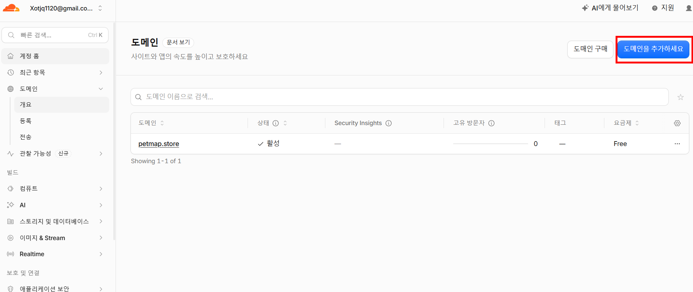
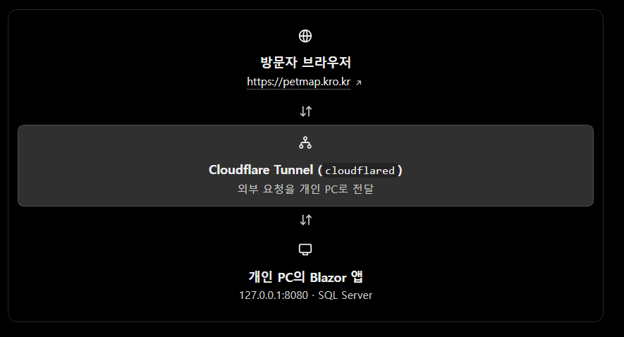

# PetMap 기술 개발·배포 기록

> 개인 Windows PC에서 개발한 Blazor 서비스를 SQL Server와 함께 AWS Lightsail에 배포하고, Cloudflare로 도메인과 외부 접속을 관리한 기술 과정을 정리한다.

- **프로젝트:** 댕동여지도 (PetMap)
- **문서 목적:** 기술 선택, 개발 환경, 데이터베이스, 배포 아키텍처, 네트워크·도메인, AI 활용 과정을 설명한다.
- **기준일:** 2026-11-14
- **읽는 방법:** 처음 개발한 개인 PC 공개 구조와 현재 Lightsail 운영 구조를 구분한다. 화면이나 과거 메모는 구성 변경 전 상태일 수 있다.

## 1. 기술 개발 개요

PetMap은 C# 기반 웹 서비스로 시작해, 로컬 PC에서 기능을 개발·검증한 뒤 AWS Lightsail의 Linux 인스턴스에서 상시 운영하도록 발전했다.

개발과 운영은 같은 애플리케이션 코드를 사용하지만 실행 환경과 DB를 분리한다.

- **로컬 개발:** Windows, Visual Studio, ASP.NET Core Blazor, SQL Server LocalDB
- **저장소:** Git과 GitHub
- **운영:** Ubuntu 기반 AWS Lightsail, Docker Compose, ASP.NET Core 앱, SQL Server 컨테이너
- **도메인·DNS:** Cloudflare에서 petmap.store DNS 관리
- **HTTPS:** 운영 인스턴스의 Caddy가 HTTPS 연결과 인증서 발급·갱신을 처리
- **지도:** Kakao Maps JavaScript SDK와 JS Interop
- **데이터 접근:** Entity Framework Core와 마이그레이션

## 2. 기술 선택

### 웹 애플리케이션

- C#과 ASP.NET Core Blazor Server를 사용한다.
- Razor 컴포넌트로 화면을 만들고 서버 측 C# 로직과 연결한다.
- 브라우저 지도는 Kakao Maps JavaScript SDK가 담당하며, Blazor와 JavaScript는 JS Interop으로 통신한다.

### 데이터베이스

- 로컬 개발은 SQL Server LocalDB를 사용한다.
- 운영은 Lightsail의 Docker 환경에서 SQL Server를 실행한다.
- EF Core가 모델과 데이터베이스 간 접근을 담당하며, 스키마 변경은 마이그레이션으로 관리한다.

### 코드와 배포

- GitHub는 코드 버전 관리와 원격 저장소 역할을 한다. GitHub에 코드가 올라간다고 앱 서버가 자동으로 호스팅되는 것은 아니다.
- Lightsail에서 저장소를 받아 Docker 이미지를 빌드하고 Compose로 앱·DB·프록시를 실행한다.
- Caddy가 외부 HTTPS 연결을 받고 앱 컨테이너로 전달한다.

## 3. 개발 및 운영 아키텍처

### 3.1 로컬 개발 구조

개발자는 Windows PC에서 코드를 수정하고 로컬 DB에 연결해 기능을 확인한다. 이때 브라우저에서 localhost로 접속한다.

```text
개발자 브라우저
      │
      ▼
ASP.NET Core Blazor 앱 (Windows / localhost)
      │
      ├── Entity Framework Core
      │       ▼
      │   SQL Server LocalDB
      │
      └── Kakao Maps JavaScript SDK
```

로컬 개발 서버는 기본적으로 개인 PC 안에서 접근하는 환경이다. 외부 공개가 필요했던 초기 테스트에는 Cloudflare Tunnel을 사용했다.

### 3.2 현재 Lightsail 운영 구조

현재 운영 구조는 개인 PC가 아니라 Lightsail 인스턴스에서 앱과 DB를 실행한다. Cloudflare는 도메인 DNS 요청을 운영 인스턴스로 연결하고, HTTPS는 Caddy가 처리한다.

```text
방문자 브라우저
      │ HTTPS: https://petmap.store
      ▼
Cloudflare DNS (petmap.store → Lightsail 고정 IP)
      │
      ▼
Lightsail 인스턴스 (Ubuntu)
      │
      ├── Caddy 컨테이너: 80/443 수신, HTTPS 인증서, 역방향 프록시
      │       ▼
      ├── PetMap 컨테이너: ASP.NET Core Blazor 앱
      │       │
      │       └── Docker 내부 네트워크
      │               ▼
      └── SQL Server 컨테이너: PetMapDB
```

데이터베이스 포트는 웹 공개 포트와 분리하고, 앱과 DB는 Docker 내부 네트워크에서 통신하도록 구성한다. 인터넷에 SQL Server 포트를 직접 공개하지 않는 것이 운영 원칙이다.

### 3.3 초기 개인 PC 테스트 구조

초기 구성에서는 공개 도메인 요청을 Cloudflare Tunnel이 개인 PC의 로컬 앱으로 전달했다. 이 구조는 Lightsail 운영 구성과 다르다.

```text
테스트 방문자
      │
      ▼
Cloudflare Tunnel (cloudflared)
      │ 암호화된 아웃바운드 터널
      ▼
개인 Windows PC의 Blazor 앱
      │
      ▼
SQL Server LocalDB
```

Cloudflare Tunnel은 PC에서 Cloudflare로 먼저 연결을 만들고, 외부 요청을 그 연결을 통해 로컬 서비스로 전달한다. 공유기 포트 포워딩 없이 개발 서버를 시험할 수 있지만, PC·앱·터널이 모두 실행 중이어야 한다. 테스트용 터널과 Lightsail 운영 도메인을 혼동하지 않도록 별도 호스트명을 사용한다.

## 4. Cloudflare의 역할

Cloudflare는 PetMap에서 DNS와 초기 테스트 터널에 사용한다. 역할을 구분하면 다음과 같다.

### DNS

DNS는 petmap.store 같은 도메인 이름을 서버 IP 주소에 연결한다. 운영 도메인은 Lightsail 고정 IP를 가리키도록 구성한다. IP가 바뀌지 않도록 고정 IP를 사용한다.

Cloudflare DNS에서 도메인을 관리하려면 등록 기관의 네임서버도 Cloudflare가 안내한 값으로 설정되어 있어야 한다.

### 프록시와 HTTPS 경로

Cloudflare DNS 레코드의 프록시 설정 여부에 따라 방문자 요청이 Cloudflare 프록시를 통과할 수 있다. 원본 서버의 80/443 접근 및 Caddy 인증서 발급 방식과 함께 설정을 확인해야 한다. 실제 값은 Cloudflare DNS 대시보드의 현재 레코드 상태를 기준으로 한다.

### Cloudflare Tunnel

- 로컬 앱을 외부에서 시험할 때 사용할 수 있다.
- Named Tunnel은 지정한 테스트 호스트명을 터널에 연결해 반복 사용한다.
- Quick Tunnel은 임시 테스트 주소이므로 고정 운영 도메인 용도로 사용하지 않는다.
- 현재 Lightsail 운영 경로에서는 Tunnel이 요청을 개인 PC로 보내지 않는다. 운영 도메인은 DNS를 통해 Lightsail에 연결한다.

## 5. 로컬 DB와 운영 DB

### 로컬 개발 데이터베이스

SQL Server LocalDB는 개발 PC에서 빠르게 화면과 데이터 기능을 확인하기 위한 데이터베이스다. 로컬 변경 사항은 운영 DB에 자동으로 복사되지 않는다.

### 운영 데이터베이스

Lightsail 운영 DB는 Docker 볼륨에 저장된다. 컨테이너를 다시 만들더라도 영속 볼륨이 유지되도록 관리해야 한다. 앱은 Compose 환경 변수의 연결 문자열로 DB 서비스에 접속한다.

### 스키마 변경과 데이터 이관은 별도 작업

- **스키마 변경:** EF Core 마이그레이션을 코드에 추가하고, 배포 시 운영 DB에 적용한다.
- **장소·계정 데이터 이관:** 백업/복원 또는 검증된 데이터 적재 절차로 따로 수행한다.
- 마이그레이션은 테이블과 컬럼 구조를 바꾸는 도구이며, 로컬 DB의 모든 사용자 데이터를 자동으로 운영 DB에 복사하지 않는다.
- 운영 DB를 로컬 백업으로 덮기 전에 운영 환경에서 생성된 계정·후기·제보가 있는지 확인하고, 운영 백업을 먼저 만든다.

### 안전한 데이터 운영 흐름

1. 로컬에서 스키마와 기능을 변경한다.
2. EF Core 마이그레이션을 검토하고 코드와 함께 GitHub에 반영한다.
3. 운영 DB 백업과 용량을 확인한다.
4. Lightsail에서 최신 코드를 받아 앱 이미지를 다시 빌드한다.
5. 마이그레이션 적용 결과와 앱 로그를 확인한다.
6. 운영 장소 데이터가 바뀌는 작업은 스키마 배포와 분리해 계획한다.

## 6. Lightsail 배포 구성

### 인스턴스 구성

- Ubuntu 인스턴스에서 Docker Engine과 Docker Compose를 사용한다.
- Compose 서비스는 PetMap 앱, SQL Server DB, Caddy 프록시로 구성한다.
- Caddy는 외부 80/443 포트를 받아 앱으로 전달한다.
- SQL Server는 Compose 내부 네트워크에서 앱이 접근하도록 둔다.
- 업로드 파일과 ASP.NET Core Data Protection 키는 영속 저장소를 사용한다.

### 방화벽 방향

- TCP 80과 443은 웹 접속과 HTTPS 인증서 발급·갱신을 위해 허용한다.
- TCP 22는 관리에 필요한 본인 IP 또는 관리 경로로 제한한다.
- SQL Server 기본 포트 1433은 공개 인바운드 규칙으로 열지 않는다.

### 배포 업데이트

운영 인스턴스의 프로젝트 디렉터리에서 GitHub의 변경 내용을 반영한 뒤 앱을 재빌드하고 실행 상태와 로그를 확인한다. 설정 파일의 비밀번호나 API 키를 Git 저장소에 올리지 않고 인스턴스의 환경 변수 파일로 관리한다.

## 7. 도메인과 TLS 흐름

운영 도메인 petmap.store는 Cloudflare DNS에서 Lightsail 고정 IP를 가리킨다. 방문자는 HTTPS로 접속하고, Lightsail의 Caddy가 요청을 PetMap 앱 컨테이너로 프록시한다.

- 도메인 소유·등록과 DNS 호스팅은 서로 다른 역할이다.
- DNS 변경 후 전파 시간 동안 기존 주소와 새 주소가 다르게 보일 수 있다.
- Caddy가 자동 TLS를 사용하려면 도메인이 원본 서버를 올바르게 가리키고 80/443 연결이 가능해야 한다.
- Cloudflare 프록시 상태, Caddy 인증서 방식, DNS 레코드가 서로 맞아야 한다.
- 장애가 발생하면 DNS 해석, 인스턴스 방화벽, Docker 포트, Caddy 로그, 앱 로그 순으로 확인한다.

## 8. GitHub와 개발·배포 흐름

GitHub는 변경 이력을 보관하고 로컬 개발 환경과 Lightsail 사이에 코드를 전달한다.

```text
로컬 Windows 개발
  → 기능 수정과 로컬 확인
  → Git commit / push
  → Lightsail에서 Git pull
  → Docker 이미지 빌드
  → Compose 앱 갱신
  → 로그와 도메인 접속 확인
```

DB 스키마와 데이터는 코드 배포와 다르게 취급한다. 앱을 업데이트했다고 LocalDB 레코드가 Lightsail DB로 자동 복사되지 않는다.

## 9. AI를 활용한 개발 방식

AI는 프로젝트의 요구사항을 코드와 운영 작업으로 옮기는 보조 도구로 사용했다. 최종 결과를 자동으로 신뢰하기보다 실제 프로젝트 상태와 명령 실행 결과를 바탕으로 반복 확인했다.

### AI에 맡긴 일

- 초기 기획과 사용자 요구를 기능 목록·화면 흐름으로 정리
- Blazor, EF Core, SQL Server 기반 구현 방향과 코드 변경안 작성
- 장소 관리, 사용자 제보, 검색과 카테고리 UI 등 기능 개선
- 코드 구조와 배포 설정 검토
- 오류 로그를 읽고 원인 후보와 단계별 확인 명령 제안
- Windows PowerShell, SSH, Docker Compose, SQL Server 백업·복원 작업 안내
- LocalDB와 Lightsail DB 차이, 마이그레이션과 데이터 이관 절차 설명
- 기술 문서와 Notion용 프로젝트 기록 초안 작성

### 사람이 확인한 일

- 요구사항과 실제 동작을 비교해 수정 범위를 결정
- 개발자 도구, 콘솔, 서버 로그와 DB 조회 결과를 AI에 제공
- 명령 실행 위치(Windows PowerShell 또는 Lightsail SSH)를 구분해 실제 실행
- DB 백업·복원 결과와 웹 서비스 접속을 직접 확인
- API 키와 비밀번호를 환경 변수로 보관하고 저장소 반영 여부를 확인
- AI가 제시한 수정안이 프로젝트 구조와 운영 데이터에 맞는지 검토

### 반복 개발 루프

```text
요구사항/오류 설명
  → 관련 코드·로그·환경 정보 확인
  → AI가 변경안 또는 진단 절차 제안
  → 로컬에서 수정·실행
  → 화면·로그·DB 결과 확인
  → 필요한 부분을 다시 조정
  → GitHub 반영
  → Lightsail 운영 반영과 검증
```

AI는 운영 환경에 접근하는 권한을 대신하지 않는다. 실제 배포, 방화벽, 계정 권한, DB 복원처럼 영향이 큰 작업은 명령의 실행 위치와 대상 환경을 확인하고 백업을 확보한 뒤 수행한다.

### AI 활용의 효과와 한계

- 긴 오류 로그를 단계별 원인 확인 작업으로 나눌 수 있었다.
- 익숙하지 않은 인프라 용어와 콘솔 절차를 실행 가능한 단계로 바꿀 수 있었다.
- 기획 문서와 코드 구현 사이의 누락을 발견하고 기능을 반복 개선할 수 있었다.
- AI 답변은 환경·버전·현재 설정과 다를 수 있으므로 실제 상태 출력과 공식 문서, 프로젝트 코드를 기준으로 검증해야 했다.
- 자격 증명, 개인 정보, 운영 DB 데이터를 프롬프트에 그대로 붙이지 않도록 주의했다.

## 10. 주요 문제 해결 경험

개발과 운영 과정에서 다음과 같은 문제를 해결했다.

- **도메인과 호스트명:** 루트 도메인과 테스트 서브도메인의 DNS 레코드가 중복되는 문제를 구분하고, 테스트와 운영 주소를 나눴다.
- **Tunnel과 서버 배포 혼동:** Tunnel은 로컬 PC 서비스 공개용이고 Lightsail은 상시 운영용이라는 차이를 확인했다.
- **Lightsail 502:** 앱 컨테이너 상태, 앱 시작 로그, 연결 문자열, 정적 자산 응답과 Caddy 프록시 상태를 순서대로 확인했다.
- **Kakao 지도:** 개발자 도메인 등록과 브라우저 리소스 경로·정적 자산 설정을 확인해 배포 사이트의 지도 로딩 문제를 해결했다.
- **SQL Server 데이터 이동:** LocalDB 백업을 만들고 검증한 뒤 인스턴스로 복사하고 운영 SQL Server에 복원했다.
- **마이그레이션 상태:** 운영 DB의 현재 마이그레이션과 연결 계정 권한을 확인해 앱 시작 시 DB 문제를 진단했다.
- **SSH 키 권한:** Windows 개인 키 파일 권한을 제한하고 Lightsail 접속을 확인했다.

이 항목은 프로젝트 과정의 사례다. 운영 시에는 현재 로그와 설정을 기준으로 재진단한다.

## 11. 기술 구조 다이어그램

### 11.1 애플리케이션 모듈과 데이터 관계

아래 그림은 지도, 검색, 인증, 제보·커뮤니티, 도메인 모델이 연결되는 프로젝트 구조를 설명하는 참고 다이어그램이다. 코드 구조가 변경될 수 있으므로 실제 파일 이름은 현재 저장소를 기준으로 한다.


### 11.2 Cloudflare 도메인 관리 화면

첨부 화면은 Cloudflare에서 petmap.store 도메인을 관리하는 장면이다. 이 이미지는 DNS 레코드 값이나 현재 프록시 설정을 증명하지 않으며, 실제 설정은 대시보드의 DNS 레코드에서 확인한다.



### 11.3 개인 PC 터널 테스트 흐름

이 그림은 Lightsail 운영 구조가 아니라 개인 PC의 앱을 Cloudflare Tunnel로 테스트하던 구성을 나타낸다.



## 12. 다음 기술 개선 후보

1. 운영 DB 백업·복원 절차를 정기적으로 점검하고 복구 시나리오 기록
2. 앱·DB·Caddy 헬스체크와 로그 보존 방식 강화
3. GitHub Actions 등으로 빌드·배포 자동화 검토
4. 운영 설정과 로컬 설정의 차이를 환경 변수 문서에 명확히 기록
5. SQL Server 버전·볼륨 용량·업데이트 절차 관리
6. 지도 데이터 조회량이 커질 경우 뷰포트 기반 API와 마커 클러스터링 검토
7. Cloudflare DNS, 프록시, Caddy TLS 설정을 실제 대시보드 값과 함께 운영 문서에 갱신

## 13. 회고

PetMap은 지도 화면을 만드는 것에서 시작해 실제 데이터, 사용자 계정과 제보, 운영 서버와 도메인을 갖춘 서비스로 발전했다. 로컬 개발과 Lightsail 운영을 분리하면서 애플리케이션 배포, DB 스키마 변경, 데이터 이관이 서로 다른 작업임을 경험했다.

AI는 코딩 보조뿐 아니라 문제를 설명하고 인프라 절차를 익히는 개발 파트너로 활용했다. 실제 결과는 개발자가 로그와 DB, 브라우저에서 확인하고 운영 환경에 반영했다.

## 한 문장 요약

> PetMap은 C#·Blazor와 SQL Server로 개발하고, LocalDB에서 기능을 확인한 뒤 GitHub를 통해 AWS Lightsail에 배포하며, Cloudflare DNS와 Caddy로 도메인·HTTPS를 운영하는 웹 서비스다.


